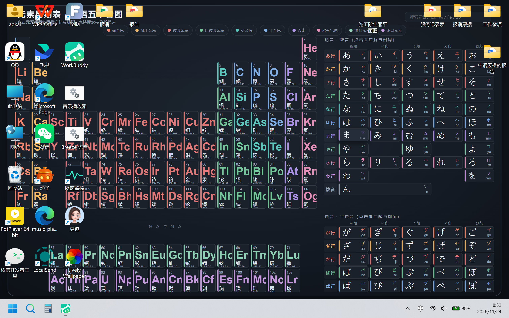

# 中文元素周期表 + 日语五十音 动态壁纸

一张图看全：118 个元素周期表 + 日语五十音图（清音、浊音、半浊音），做成可交互的动态桌面壁纸。

## 功能

- **一张图全看见**：周期表与五十音图连成一体，按屏幕比例自动铺满，不会被任务栏遮挡。
- **单击看详情**：点元素看中文名、原子量、周期、族、分类说明；点假名看平假名、片假名、罗马音、发音注解和两个例词。
- **双击朗读**：双击元素用中文语音读出详情；双击假名依次播放标准日语发音（假名 + 例词）与中文释义。详情浮层内也有「朗读」按钮，点 × 或空白处关闭。
- **分类配色 / 搜索筛选**：元素按类别配色，顶部可按中文名、符号、序号搜索，点分类圆点筛选。

## 安装

### 一键安装（推荐）

解压后双击 `安装.bat`，会自动把壁纸装进 Lively Wallpaper 并设为桌面，无需手动拖拽。

### 手动安装

1. 先安装免费软件 [Lively Wallpaper](https://github.com/rocksdanister/lively)。
2. 把本文件夹整个拖进 Lively 窗口，点一下缩略图即可。

依赖：Windows + Lively Wallpaper（免费开源）。日语发音用随包的本地音频，不联网也能读。

## 文件说明

| 文件 | 用途 |
| --- | --- |
| `index.html` | 交互式壁纸页面（118 元素 + 71 假名） |
| `voice/` | 155 个日语发音音频（假名 + 例词），约 3.1 MB |
| `LivelyInfo.json` / `thumbnail.jpg` | Lively 壁纸项目配置与缩略图 |
| `安装.bat` / `install.py` | 一键安装脚本 |
| `预览.png` | 效果预览 |

## 来源与授权

- 页面代码、布局、交互逻辑：本项目原创。
- 元素数据（名称 / 符号 / 原子量 / 分类）：公开科学常识数据，无版权主张。
- 假名与例词：日语基础知识，通用学习材料。
- **日语发音音频**：通过有道词典在线发音接口生成。据《网易有道词典服务条款》第 5 条，有道词典「仅供非商业用途，不得销售、转让、许可或以其它方式提供给任何第三方」，商用需取得有道书面授权。因此本仓库音频**仅供个人学习、自用参考**；如需商业使用或公开再分发，请先取得有道授权，或将 `voice/` 内音频替换为已获商用许可的音源（同名覆盖即可，不影响功能）。
- Lively Wallpaper 为开源软件（GPL-3.0），其商标与软件本体不属于本项目。

> 个人使用、转发给朋友自用无碍；上架市场或商用前，请先解决音频授权问题。
